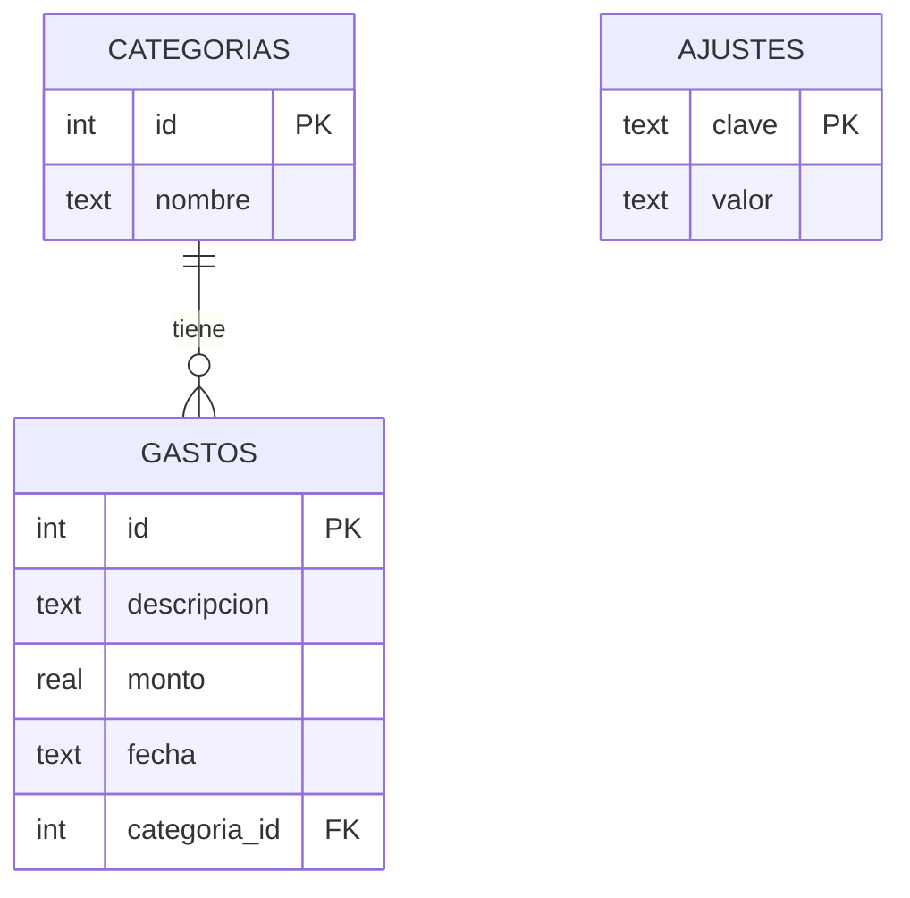

# Control de Gastos – INF662 Segundo Parcial

App móvil en Flutter para registrar mis gastos por categoría. Uso **Provider** para el estado y **SQLite (sqflite)** para que la información se conserve al cerrar la app.

> Trabajo independiente · INF662 Desarrollo de Aplicaciones Móviles · Gestión 02/2026
> **Dominio elegido:** Control de gastos (Categoría → Gasto)

## Qué hace

- CRUD completo de **categorías** y **gastos**, con confirmación (`AlertDialog`) al eliminar y `SnackBar` en cada operación.
- Detalle de categoría con sus gastos y el total gastado.
- Búsqueda por descripción (`LIKE ?` parametrizado) y filtro por categoría.
- Resumen con **total gastado por categoría** y **por mes** (`SUM` / `COUNT` con `JOIN` + `GROUP BY`).
- Estados vacíos, indicadores de carga y manejo de errores.
- Datos semilla la primera vez que se abre la app.

### Puntos extra
- **Migración:** BD versión 2 con `onUpgrade` (agrega la columna `fecha` sin perder datos).
- **Transacción:** al eliminar una categoría se borran sus gastos con `db.transaction`.
- **Tema persistente:** modo claro/oscuro con Provider, guardado en la tabla `ajustes`.

## Diagrama entidad-relación



## Estructura

```
lib/
  main.dart        MultiProvider + MaterialApp (Material 3)
  models/          Categoria, Gasto, ResumenCategoria / ResumenMes
  db/              database_helper.dart (singleton, onCreate, onUpgrade, semilla)
  providers/       CategoriaProvider, GastoProvider, TemaProvider
  screens/         categorías, detalle, gastos, formularios, resumen
  widgets/         tarjeta de gasto, estado vacío, diálogo, botón de tema
```
## VIDEO DE PRUEBA
https://drive.google.com/file/d/1ChUn9J7JeMIw7K-jKUkF_Txd9EkEqfzt/view